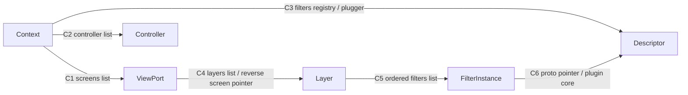
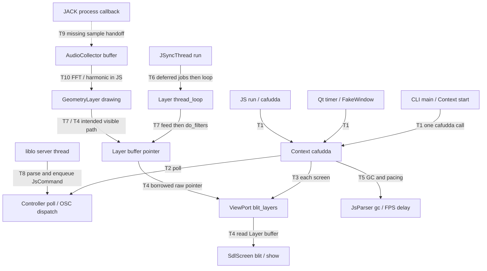
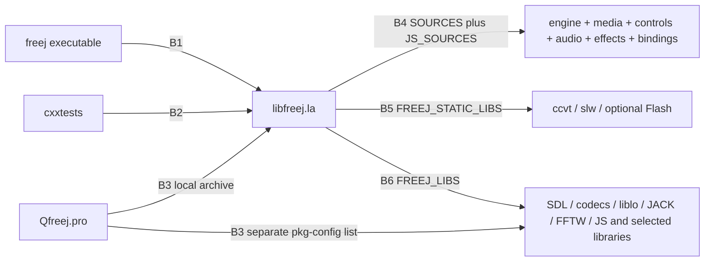
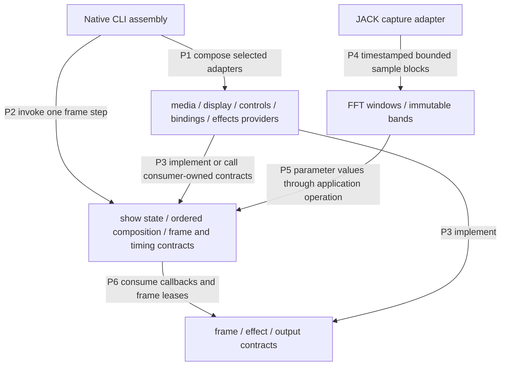

# Engine boundaries

The Linux movie layer is registered as `MovieLayer/ffmpeg` through
`src/media/movie_registration.h`. `VideoLayer` owns playback and its
decoder, and `src/media/movie_decoder.cpp` owns the FFmpeg contexts,
packet and frames. Only that translation unit uses the FFmpeg include
flags. The decoder drains both streams before it reports end of stream,
and the layer handles looping, controls and dispatch to the viewport.
The viewport binds a specific audio supplier to JACK independently of
composition order. Detaching that supplier stops the worker before
disconnecting its audio buffer. The movie replay fixture lives in
`tests/show-replay`.


Source baseline: `2afb631cb3a429fdf312627ef904ec32b51e812d`. This is a
design and source walk. The baseline diagrams include the retired Qt frontend.
Preserve `Context`, `Layer`,
`ViewPort`, `Controller`, `Filter`, public include paths, factories, scripts,
OSC routes, filter order and frontends while extracting their internals.
Paths below are relative to the repository root. Source symbols are the
navigation keys; line numbers are baseline locators.

## Frame and worker ownership

`src/Makefile.am` groups the engine, media sources and outputs, controllers,
display adapters, and JavaScript bindings. The private frame code lives in
`src/engine/`. The native scheduler in `Context::cafudda` owns SDL event
pumping, display submission, and pacing. Layer and screen factories still
register at their adapters with the existing keys.

- A layer worker owns its feed cycle and the ordered filter traversal. A source
  or filter may reuse its buffer once the worker has copied the finished frame
  into the layer's frame store. Filter instances own their output and parameter
  entries. The prototype and plug-in library must outlive those instances.
- A frame lease holds one immutable generation. It records width, height,
  packed row stride in bytes, channel layout, and a publication timestamp in
  monotonic nanoseconds. The compositor pins the layer generation for a blit.
  The legacy `Layer::buffer` points to the current pixels during a protected
  blit. It carries no ownership beyond that operation.
- When a viewport has a recorder, the native host snapshots its composed
  surface before submitting it. The encoder pins this snapshot through
  conversion, and compression uses its own YUV storage. Resize replaces the
  viewport surface on the host thread. An in-flight conversion can finish from
  its existing lease. The recorder keeps the dimensions selected at start.
- The viewport owns attached encoders and borrows attached layers. Detach
  removes the layer from the render list and closes its command queue before
  joining the worker. It cancels pending commands, releases the old frame and
  blitter, and leaves the layer available to its caller. Reattaching restarts
  a worker that was active at detach. Reset finishes attached recordings before
  detaching layers and releasing the viewport. Outstanding frame leases
  release their storage independently.
- Script object references remain on the JavaScript owner thread. Screen reset
  detaches layers before clearing script execution contexts. The existing
  SpiderMonkey class registration uses stub finalizers. The later effect
  provider work owns registry shutdown after the remaining script instances.

`make check` exercises the bounded frame step in `frame-step-test` and worker
retry, held generations, active detach and reattach, failed feeds, resize,
and recording reset in `lifetime-test`. The software replay checks staged
native dispatch, rendering, and recording.

## Baseline objects and ownership

Arrows here mean references or containment, not thread or build dependencies.
Labels C1–C6 identify edges in the source-walk table below.



| Edge | Source walk and lifetime |
| --- | --- |
| C1 | `Context::add_screen` (`src/context.cpp:185`) registers a screen; `Context::reset:448` removes and deletes non-indestructible screens. `Context::screen` aliases the selected/list screen; it is not a separate owner. |
| C2 | `Context::register_controller:345` initializes, activates and appends; `rem_controller:375` deletes; reset handles indestructible controllers separately. JS wrappers retain private native pointers, so list membership alone is not a universal lifetime rule. |
| C3 | `Context::init:202` calls `Plugger::refresh` (`src/plugger.cpp:106`), which scans directories and appends filter descriptors to `env->filters`. `Freior::open` owns a `dlopen` handle; its destructor calls `dlclose` (`src/frei0r.cpp:143`). Registry/provider lifetime must exceed every instance borrowing callbacks. This ordering is a required future contract, not verified teardown today. |
| C4 | `ViewPort::add_layer` (`src/screen.cpp:110`) requires an opened, unlisted layer, sets `screen`, installs blits and prepends. `rem_layer:159` clears the pointer and unlinks without stopping/deleting. The destructor stops layers, then unlinks without deleting; reset only unlinks. The creator/JS wrapper remains responsible for destruction. |
| C5 | `Filter::apply` (`src/filter.cpp:67`) allocates instance output, appends to `lay->filters` and sets the instance's layer. `Layer::do_filters` (`src/layer.cpp:247`) traverses begin→next under the filters-list lock. List order is artistic behavior. |
| C6 | `FilterInstance::init/process` (`src/filter_instance.cpp:66/75`) stores `proto` and dispatches its update callback. Its destructor invokes descriptor destruct and frees output. `Freior::apply/destruct/update` (`src/frei0r.cpp:283–301`) manages the plugin instance. Descriptor and instance are distinct objects. |

## Baseline execution and frame handoffs

Solid arrows are source-visible calls; dotted arrows are intended connections
whose runtime validity is unproven. These arrows do not assert synchronization.



| Edge | Definition, callers, data and limits |
| --- | --- |
| T1 | `src/freej.cpp:412–436`: open source, add to screen, explicitly start layer, loop over `cafudda(1.0)`. `Context::start:241` loops over `cafudda(0.0)`; `start_threaded:250` is an alternative owner thread. `qt/qfreej.cpp:267` calls from `updateInterface`; `qt/FakeWindow.cpp:110–132` calls during zoom reset. `src/context_js.cpp:86–111` exposes `run`/`cafudda`. The `secs` argument is currently unused by `Context::cafudda:258`: one call does one tick and delays; it does not run for that many seconds. |
| T2 | `Context::cafudda/handle_controllers:258–345` pumps SDL, polls active controllers under the list lock, flushes remaining SDL events. `OscController::poll/dispatch` (`src/osc_ctrl.cpp:154–185`) drains commands into `JSCall`. Controller callbacks can therefore change show state on the tick thread. |
| T3 | `Context::cafudda:270–291` optionally clears, handles resize, calls `blit_layers`, then `show` on each screen. `ViewPort::blit_layers` (`src/screen.cpp:230`) walks end→prev, checks buffer/active/opened, locks layer and screen around `blit`. Base `ViewPort::show:281` is empty. |
| T4 | `ImageLayer::open/feed` (`src/image_layer.cpp:59–122`) loads/converts an SDL image, allocates an SDL surface, and returns borrowed `surf->pixels`. `SdlScreen::blit:113` crops, rotates/zooms or line-blits `Layer::buffer` into screen pixels; `show:236` flips the display. `SoftScreen::blit/get_surface` (`src/soft_screen.cpp:66/115`) demonstrates a memory destination but inherits SDK-coupled headers. |
| T5 | `Context::cafudda:294–303` calls `js->gc()` despite the disabling comment, then `fps.calc/delay`. Each layer also paces itself in `thread_loop`. A Qt timer does not remove the delay inside the tick. |
| T6 | `JSyncThread::start/_run/stop` (`src/jsync.cpp:60–96`) creates a joinable pthread, drains deferred jobs before setup and each loop, and joins on stop. `Layer` inherits this mechanism. `src/layer_js.cpp:411` starts it explicitly; `qt/QqWidget.cpp:50–52` adds/starts image layers. JS `ctx_add_layer` (`src/context_js.cpp:175`) only delegates to `Context::add_layer`; it does not start a worker. |
| T7 | `Layer::thread_loop:143` calls virtual `feed`, then `do_filters` when non-null, then assigns `buffer = tmp_buf`. `FilterInstance::process` calls descriptor update; output is an instance-owned allocation. The comment promises a memcpy but none occurs here; publication and producer writes do not take the layer mutex. Consumer locking alone does not establish safe publication or immutable pixels. `Layer::cafudda:232` runs iterators, but the active `ViewPort::blit_layers` path does not call it. The old API's synchronous-feed tree is not the current source path. |
| T8 | `osc_command_handler` (`src/osc_ctrl.cpp:64–134`) validates route/type strings, creates JS numbers/strings from borrowed liblo args and appends a `JsCommand`; `dispatch:162` calls JS and frees argv/command. The constructor registers a liblo server-thread handler (`:240–245`); `start:274` starts it. Allocation of JS values on that producer thread, rooting and queue synchronization are unproven. `scripts/javascript/examples/osc_test.js` registers `/test`, `ifs`, and a callback; numeric/string conversion exists, but a source TODO says arguments fail at invocation. A loopback run remains required. |
| T9 | `JackClient::Attach` (`src/audio_jack.cpp:87`) registers `Process:162`. JACK owns input buffers for the callback interval; `nframes` counts samples per channel. Active input code can write the first channel into an encoding ringbuffer when encoding. `AudioCollector` constructor (`src/audio_collector.cpp:121–126`) comments out `SetCallback` and `SetInputBuf`; `JackClient::Process:173/265–268` comments out capture copy/callback. Consequently JACK→collector live capture is an explicit broken/unproven edge, not a tested PCM path. Do not confuse decoder-audio playback via `ViewPort::add_audio` with FFT capture. |
| T10 | `AudioCollector::AudioCallback_i:291` would copy float samples into its mutex-protected buffer. `GetFFT:195` copies to scratch, executes FFT, groups bins and applies gain/smoothing; `GetHarmonic:190` reads output. `src/audio_collector_js.cpp:117/177` exposes `get_harmonic` and `fft`; `scripts/javascript/examples/audio_test.js` calls both in a TriggerController callback and maps magnitude to GeometryLayer line heights/color. Magnitudes are algorithm-specific values, not dB or normalized parameters. This is a complete source-intent walk to visible geometry, with T9 and runtime drawing parity outstanding. |

A concrete image/filter source walk is
`scripts/javascript/examples/filter_image.js`: `doc/ipernav.png` →
`ImageLayer::open/feed` → `Layer::thread_loop` → the instance selected by
`new Filter("Distort0r")` and attached by `layer_add_filter` →
`Layer::do_filters` → published `buffer` → `ViewPort::blit_layers` →
`SdlScreen::blit/show`. `filter_constructor` (`src/filter_js.cpp`) resolves
the named descriptor from `global_environment->filters` and creates an
instance. The script's TriggerController updates Frequency/Amplitude through
the same instance's parameter callbacks. Plugin presence, successful output and
publication safety remain runtime prerequisites; the checked-in script is an
example, not a golden replay fixture.

### Frame and stop contracts to establish before extraction

Current `Geometry` (`src/include/geometry.h`) carries width/height in pixels,
bpp in bits, `bytewidth` in bytes per row, and total pixel/byte counts.
The engine assumes 32 bpp (`ViewPort::init:92`), but 32 bpp alone does not
specify channel order, alpha convention, endian interpretation or padding.
SDL bitmasks and plugin color-model validation must accompany each adapter.
Current raw frame pointers do not carry timestamps or validity intervals.
`Layer::do_filters` passes measured `fps.fps` as the plugin time argument;
`Freior::update` forwards it unchanged. Do not silently reinterpret that value
as elapsed seconds during a move: capture parity, then correct with an explicit
compatibility decision if required.

An additional reader is the encoder worker: `ViewPort::add_encoder`
(`src/screen.cpp:178`) initializes/starts it and appends it to the screen.
`VideoEncoder::thread_loop` (`src/video_encoder.cpp:179–247`) borrows
`screen->get_surface()`, paces, locks the screen for format conversion, and
then unlocks before encoding. It assumes width-times-four stride. That source
walk establishes a second lifetime consumer, not proof that an SDL surface lock
is a cross-thread frame-publication mutex.

The proposed private frame contract records dimensions, byte stride, explicit
pixel/alpha format, monotonic timestamp with named unit, owner and read-validity
interval. Producers finish a frame before publishing it. A lease or owned copy
keeps pixels stable through the last compositor/encoder read. ImageLayer owns
its surface; each FilterInstance owns its output; neither may free/overwrite a
published frame while a consumer holds it. No new public parallel object model
is required. Preserve today's worker concurrency until measured.

For stop/reset: stop new commands and frame admission, quiesce OSC/JACK callbacks,
join workers, retire instances, then release source/output buffers and providers.
This is a target dependency order, not a claim about current reset. A counterexample
already exists: `ViewPort::rem_layer` unlinks and clears `screen` without stopping
the worker; `ImageLayer::close` frees its surface while `buffer` can still alias
it. A consumer lock does not cover producer writes. The future removal operation
must join/quiesce and wait for outstanding reads before destruction, while
preserving the old facade's distinction between removal and deletion.

## Baseline build and link graph

These arrows mean compile/link dependencies. They are separate from object
ownership and runtime calls.



| Edge | Source boundary |
| --- | --- |
| B1 | `src/Makefile.am:75–77`: native `freej.cpp` links `libfreej.la` and X11. |
| B2 | `tests/Makefile.am:1–21`: one `cxxtests` executable generated from `testClosure.h`, linked to all of libfreej; the header has two arithmetic checks, not frame/OSC/audio parity. |
| B3 | `qt/Qfreej.pro:40–46`: local libfreej and bundled JS archives plus a separate pkg-config list for SDL, Cairo, codecs, shout, JACK, FFTW, samplerate and liblo. Qt source callers are not isolated from native engine dependencies. |
| B4 | `src/Makefile.am:8–73`: one library source list combines engine, adapters and JS. At this baseline **neither `video_layer.cpp` nor `ffdec.c` occurs in the active list**, although configure defines `WITH_FFMPEG` and Context calls the MovieLayer factory. Diagnose generated targets in the reference build before selecting a decoder edit; presence on disk does not prove a compiled target. |
| B5 | `configure.ac:865–907` defines shared aggregate compile flags and vendored archives. `FREEJ_STATIC_LIBS` does not promise a fully static application. |
| B6 | `configure.ac:909–945` aggregates native libraries; FFmpeg/liblo probes are mandatory in the current configure flow, while source guards such as `WITH_AUDIO`, `WITH_FREI0R`, `WITH_JAVASCRIPT`, `WITH_OPENGL`, `WITH_AALIB` and device-specific guards select implementations. Guards are not a portable target boundary. |

`context.h` directly includes SDL, layer, screen, plugger and shouter;
`layer.h` includes screen/filter/jsync; `screen.h` includes SDL and layer;
`filter.h` includes parameter/instance headers, and the shared `Entry` exposes
JS object/class pointers (`src/include/linklist.h:149–157`). A facade can remain coupled
for compatibility while a new private core contract stops including it. Moving
these headers wholesale would reproduce the dependency cycle.

### Legacy build observation

On 2026-11-25, a clean `git archive` export of the baseline on Linux x86-64,
Debian GCC/G++ 14.2.0, was bootstrapped with `autoreconf -fiv` (exit 0).
A separate empty build directory ran
`CC='ccache gcc' CXX='ccache g++' ../baseline-source/configure` (exit 1):
S-Lang, SDL, Ogg, Vorbis and Vorbisenc were found; Theora development files
were not. No application compilation, native frame replay or `make check` executed.
The build profile is the existing configure defaults; no dependency was
installed or changed. This reproduces the known prerequisite failure and
does not establish a working reference build. L1's design gate is a source
walk; a successful reference build remains a later mandatory gate before
crossing an implementation seam.

## Intended direction and extraction gates

Arrows mean source dependencies on narrow private contracts, not an instruction
to introduce a class for every box. No groups below are independently buildable
yet.



| Edge | Owner, acceptance and dependency movement |
| --- | --- |
| P1 | Application assembly owns factory/provider selection and native scheduling. Retain native compatibility directory loading and existing frontends; the static profile selects built-ins. Runtime JACK/display servers, assets and fonts are resources rather than link libraries. |
| P2 | Engine/composition owns show state, ordered layers/filters, parameter values and a one-tick step that returns control. SDL events, presentation and pacing leave the step; retain `Context::cafudda` as a compatibility wrapper with current caller behavior until parity is proved. Include CLI and JS calls in that proof. |
| P3 | Media owns decode/capture/conversion/encode/backpressure and frame lifetime. Controls/bindings own protocol parsing and script-object lifetimes. Display owns SDL surfaces. Effects own validation, shared instance/parameter processing and provider lifetime. Inject implementations at assembly; core headers include none of SDL/Qt/JS/liblo/JACK/FFmpeg/dlopen. |
| P4 | Audio analysis owns the existing FFT algorithm, windows, gain/smoothing and output snapshots. Move FFT into its own translation unit before claiming its test is independent of JACK. JACK only supplies timestamped sample blocks with sample rate/channel layout and explicit overflow behavior; callbacks do bounded handoffs, not FFT/JS work. Tests can supply identical blocks. T9 needs a regression fixture first. |
| P5 | Bindings translate immutable bands into the same engine operations used by other inputs; copying liblo values precedes returning from the producer callback, and JS conversion/execution stays on the runtime owner thread. Hardware-free operation tests and transport-specific loopback tests establish different contracts. |
| P6 | Effect instances die before their provider. Compositor and encoding consumers retain frame validity independently; slow encoding/backpressure must be measurable without moving the render deadline. Keep the existing format/time behavior under fixtures before changing semantics. |

First build boundary: create a portable core target plus a memory fixture that
compiles with only its declared headers/libraries, separately from the legacy
facades and adapter targets. The check must fail for a device/codec/script SDK
include in a portable header. Record each moved source in target lists; retain
current entry points until replacements are tested. No generic message bus,
empty layer hierarchy or broad source move is justified by this note.

## Three change rehearsals

The following are paper diffs and acceptance fixtures, not implemented APIs,
new OSC routes or build targets. Proposed private names describe responsibilities;
the implementation milestones choose names consistent with the code they extract.
Every failed sketch below has a correction and a hardware-free fixture. SDKs
needed to build an adapter are separate from devices needed to run it.

### R1 — Replace one decoder API call

**Entry point and owner.** The media adapter owns
`VideoLayer::decode_video_packet` (`src/video_layer.cpp:616–680`). It selects
`avcodec_decode_video` or `avcodec_decode_video2` by a version guard and returns
consumed bytes plus `got_picture`. `feed:447–475` advances packet pointers,
converts the picture and publishes the RGBA buffer. Decoder types are currently
in `src/include/video_layer.h` and initialization also leaks into
`Context::init`. First resolve B4's missing source-list entries in the reference
build: editing `src/ffdec.c` is not evidence of changing MovieLayer.

**Smallest coherent edit set and reusable type.** Rehearse replacing
`avcodec_decode_video2` with the FFmpeg 7.1 send/receive protocol. The paper diff
touches the movie adapter's decode/feed/seek/close state and private decoder
storage, its target source list, and its clip fixture. Hide AVPacket/AVFrame and
codec headers in an adapter-owned implementation; keep the old VideoLayer facade
callable. Its engine-facing result is the same explicit frame lease/format/time
contract consumed by the compositor, plus frame/not-ready/end/error status.
Core composition, OSC and FFT algorithms do not gain FFmpeg includes.

```diff
- feed assumes decode_video_packet returns consumed bytes and at most one picture
- decode_video_packet calls avcodec_decode_video2
+ adapter retains packet until accepted, drains decoded frames into bounded state
+ feed obtains the next converted frame lease without exposing codec state
+ seek/loop reset decoder state; end-of-input drains delayed frames before EOS
```

**Ownership and failed-sketch correction.** A one-line substitution fails:
send/receive separates packet acceptance from frame output. A packet can yield
zero or multiple frames; EAGAIN requires progress on the opposite side. Retain
packet references until accepted, hold decoded-frame references through
conversion, and release only after copying/retaining the published output.
Drain with null input at EOF, consume output to EOF, and flush before reuse.
These protocol requirements come from the
[FFmpeg 7.1 send/receive overview](https://ffmpeg.org/doxygen/7.1/group__lavc__encdec.html).
They require an adapter state-machine change rather than a renamed call. Do not
alter the engine's existing filter-time interpretation incidentally.

**Fixture and link impact.** Pin a short redistributable clip and decoded frame
bytes from the working reference, with dimensions, stride, channel order,
timestamp sequence/timebase and file hashes. Include delayed/B-frame output,
EOF drain, seek-to-start/loop, no-video and corrupt/truncated input. The decoder
fixture runs without SDL display, JACK or JS; it still links the selected
FFmpeg SDK. Replay its recorded frames separately through the memory compositor
to distinguish decoding from composition failures. Exact frame bytes are the
default comparison; any version-dependent tolerance needs an explicit recorded
reason and reference output, never blanket hash relaxation. Only the media
target's codec flags/libraries change; the portable fixture/FFT target must
still compile without them. Other removed SDK APIs may need adapter-local
changes in the later FFmpeg migration; this sketch is not a complete upgrade.

**Rollback.** Keep the legacy SDK/profile and clip oracle. Revert the decoder
slice and its target selection together; retain unrelated dependency pins.
Unchanged facade callers and the compositor replay must keep working. Block
that migration if the legacy clip cannot be reproduced first.

### R2 — Route an existing position control through another frontend

**Entry point and owner.** Reuse the existing `Layer::set_position(x,y)`
operation. The JS binding (`src/layer_js.cpp:222–235`) converts two integers.
The method queues `_set_position` on the layer worker
(`src/layer.cpp:318–327`), which updates integer pixel coordinates and marks
crop dirty. Controls/bindings own routing and conversion; the layer owns the
position mutation.

**Smallest edit set and reusable type.** A show could opt into an OSC
`/layer/position` route with an `ii` payload bound to its selected layer. This
is a proposed show-local route for the rehearsal; the repository's existing OSC
example only registers `/test` with `ifs`. Keep that example/route and all
existing callbacks intact. Modify the opt-in script/OSC adapter and its fixture.
The route calls `set_position`. Integer pixel values and a lifetime-safe layer handle
are sufficient. A new transport does not justify another show model or a bus.

```diff
- hypothetical OSC callback writes layer.geo.x/y from liblo's server thread
+ server callback copies validated scalar payload into an owned pending command
+ owner-thread dispatch resolves the live layer and invokes its set_position(x,y)
```

**Ownership and failed-sketch correction.** Direct writes bypass the deferred
worker operation and crop invalidation; borrowed liblo data expires when its
callback returns. Creating JS values there also crosses the runtime-owner
boundary (T8). Queue owned scalar values, perform JS conversion/callback on the
runtime owner thread, then use the existing layer command path. Preserve callback
names, payload type checks, delivery order and existing integer conversion
semantics; characterize range behavior before changing it. Resolving a layer
before enqueueing is insufficient if removal can race its later application:
reject retired handles and fence/drain already-admitted work during removal.
This thread repair belongs to the control migration, not this design change.

**Fixture and link impact.** Feed equivalent `(12,34)` and negative/cropped
positions through the shared operation in a memory
show; advance the controlled worker until its deferred job is observed, then
compare position/crop state and pixels. No display or JACK server is needed.
Separately exercise the OSC path with a loopback `ii` packet, wrong type/arity,
copied payload after callback return, ordered rapid updates and a removed-layer
case. This loopback fixture needs liblo and the binding runtime. Run it with
a real loopback packet. The portable operation fixture needs neither SDK.
Link liblo and JS only to the control adapter.

**Rollback.** Remove the opt-in route/adapter slice and restore its captured
behavior without changing `Layer::set_position` or existing scripts.
If the memory operation passes but loopback fails, keep the
operation and diagnose transport/lifetime handling separately.

### R3 — Discover an existing frei0r effect from a static registry

**Entry point and owner.** Effects discovery starts at `Plugger::refresh`
(`src/plugger.cpp:106–207`). Its directory provider scans search-path order,
walks `alphasort` results backwards, calls `Freior::open` and registers filter
or source descriptors. `Freior::open` resolves callbacks with dlopen/dlsym;
`Freior::apply/update` and parameter callbacks own processing, not discovery.
The effects provider owns loaded code and initialization; instances borrow its
callbacks and own their core/output allocations.

**Smallest edit set and reusable type.** Extract a typed callback descriptor
accepted by the existing host; supply it from a directory provider or a bundle
provider selected at assembly. Private descriptor validation and provider
lifetime logic are shared; keep current Filter/FilterInstance names and bindings.
Change `plugger.cpp`, the provider-specific loader and private host wiring,
selected profile target/link lists and provider-equivalence fixtures. Do not
copy `Freior::update`, parameter conversion or instance allocation into a static
branch. The static profile links its selected bundle; compatibility retains
directory loading and third-party effects. Keep FreeFrame discovery selectable.

```diff
- Plugger refresh discovers path; Freior open resolves symbols into host members
+ directory provider resolves symbols into a validated typed descriptor
+ bundle provider enumerates immutable descriptors into the same host contract
  one instance/parameter/frame-processing implementation consumes either result
```

**Ownership and failed-sketch correction.** A static branch that calls global
`f0r_*` symbols fails for multiple linked effects and duplicates parameter rules.
The pinned read-only sibling at
`8bd7873af265493b69b39f5274851bfca59ebefd`,
`../frei0r/include/frei0r/bundle.h`, instead exposes
`f0r_bundle_plugin_count/by_index/by_id` and per-plugin callback descriptors.
Validate descriptor size/version, required callbacks and plugin kind/color model
before registration, with update versus update2 requirements appropriate to the
kind. Initialize before constructing; destruct every instance before deinit;
only then unload/release the provider. Do not unload a directory module on refresh
while an instance still borrows its callbacks. Canonical bundle IDs and visible
plugin names serve different roles: preserve display names and captured legacy
search/duplicate precedence. A duplicate-name ambiguity needs an explicit policy
and fixture before migration, not a silent new sorting rule.

**Fixture and link impact.** Run the same explicit-format input/time sequence
through directory and static `invert0r` instances (visible name `Invert0r`); compare descriptor metadata,
pixels and create/reset/destroy order. Test `onecol0r` separately as a source
with color parameters to cover shared conversion and source classification;
do not pretend it is a filter. Add fake malformed descriptors, absent callbacks,
unsupported kinds, duplicate names/IDs, failed construction and provider release
with a live instance. These can run in a memory host without display, JACK,
liblo or JS. The current sibling `test/bundle-native-consumer.c` checks descriptor
availability, not FreeJ rendering or lifecycle parity; it cannot replace that
host fixture. The built-in profile must omit dlopen dependency from its provider;
the compatibility provider retains the platform loader dependency. Public core
contracts must include neither dlfcn nor the bundle implementation.

**Rollback.** Switch assembly/profile selection back to the directory provider
and retain captured plugin order. Revert provider integration without undoing
shared processing parity or independent decoder pins. The built-in provider is
not a completed static show until the later full-profile rendering gate passes.

## First vertical slice and removal counterexample

**S1 — Image → existing filter → memory screen, with old facade.** Start with a
tiny explicit RGBA test pattern plus the existing `doc/ipernav.png` asset, and
the existing `invert0r` effect from the directory provider. Capture the legacy
output before extracting anything. A test host supplies a memory destination,
fixed dimensions/stride, known clear contents and deterministic tick/time values.
Image decode owns its converted bytes; an instance transforms them; the
compositor reads a stable frame lease and blits into a destination it owns.
Compare decoded input, filtered intermediate and final output independently,
including a nonzero offset/crop and a second tick. This identifies which
boundary changed. Retain channel order/alpha masks explicitly; `SoftScreen`
reports RGBA32 while SDL reports BGRA32, so comparing unlabelled words is invalid.

The smallest extraction is a consumer-owned frame view/lease and one frame-step
operation behind the current facades, plus a memory-output adapter and its
fixture. `Context::cafudda`, `Layer` and `ViewPort` remain callable wrappers;
their current start/add/run behavior stays covered in a legacy integration test.
The portable host calls the step directly and injects source/output/effect
implementations without initializing native devices. Do not instantiate today's
Context and call that a portable fixture: its constructor initializes JS/FFmpeg
and plugin discovery, and its tick pumps SDL, collects JS and delays. Move
assembly out of that path with compatibility defaults and test-host injection.
Proposed edit scope: extracted private contracts/step, facade delegation,
image/display/effect adapter wiring, target lists and the replay fixture.

Use current `SoftScreen` as a behavioral reference, not an already portable
implementation: it inherits SDL-coupled `screen.h`, allocates a raw buffer and
inherits an empty `clear`. Explicitly initialize fixture pixels and define clear
behavior. Do not pass stack/borrowed storage to `SoftScreen::set_buffer`: its
destructor frees the installed pointer. The portable memory adapter needs an
explicit owning/borrowed storage contract. A legacy image oracle may need SDL's
dummy video driver and pinned SDL_image SDK because `ImageLayer::open` uses
display-format conversion. Keep a decoded-byte fixture so the portable core
test needs neither SDL nor a display server.

**S2 — Failure schedule and correction.** Hold a frame read lease after worker
publication; request layer removal; let another worker tick/queued position
command attempt progress; request source/provider destruction; finally release
the reader. Today's `rem_layer` only unlinks, `thread_loop` writes a raw pointer,
and `ImageLayer::close` frees its surface. A sketch that merely locks the layer
during unlink fails: the producer does not take that lock, queued work can target
the old object, and an encoder may still read screen pixels.

Correct the owning application operation: close admission and invalidate new
handles, quiesce callbacks, stop/join the producer without holding a mutex it
needs, settle/cancel queued work, wait for outstanding read leases, then retire
instances and buffers; release the provider last. Preserve detach-without-delete
semantics for old callers by retaining creator ownership after safe detachment.
The deterministic memory fixture must use barriers/event acknowledgements rather
than sleeps, assert no writes after quiescence, prove the reader still sees valid
bytes until release, and verify all threads/jobs settle even on failure. Repeat
with slow encoding and failed feed to cover the extra consumer. No hardware is
needed; device callback adapters get separate rig checks later.

**S3 — Acceptance and rollback.** Gate the slice on the pinned reference replay,
equivalent old-facade and direct-step output, the deterministic removal schedule,
and a core-only compile with no SDL/JS/liblo/JACK/codec/dlopen headers or
libraries. Retain old CLI and binding call-site checks and the full applicable
suite. Check the unchanged native compatibility build independently of the
portable target; a passing memory fixture is not native runtime parity. Reverse
the facade delegation/source-list slice if pixels, ordering, lifetime or caller
behavior diverges, leaving dependency pins and unrelated adapters available.
The cost is explicit frame ownership and a small composition seam; the benefit
is a reproducible frame/removal test without a stage rig. Avoid redesigning
the worker model or all media sources before this one path proves the boundary.
